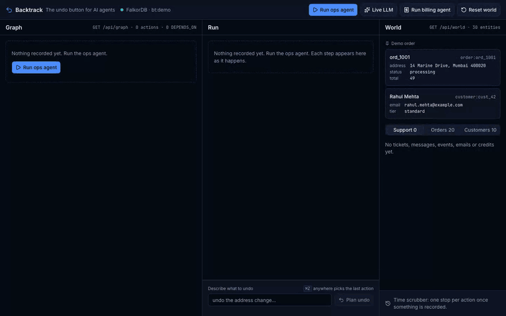
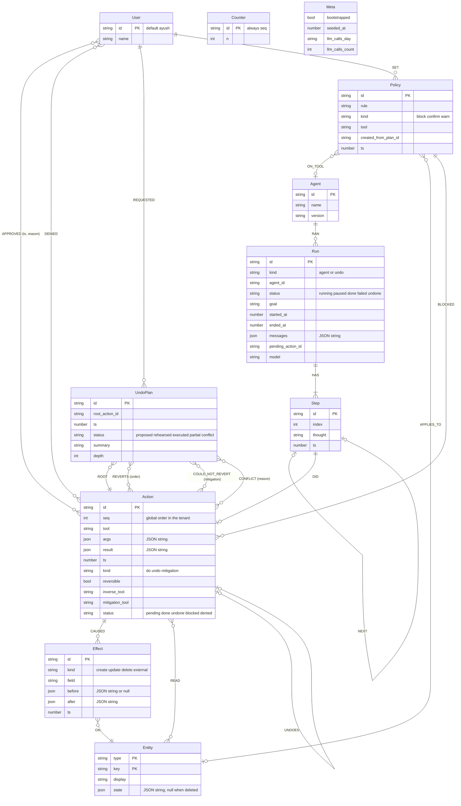

# Backtrack — the undo button for AI agents

Backtrack records every action an AI agent takes as a cause-and-effect graph in FalkorDB, and computes safe undo plans from it: what to revert, in which order, what cannot be reverted, and which other agents are affected.

<!-- TODO(BT-068): 30 s demo GIF here, e.g.  -->

Built for **Graph Hacks: Context for AI Agents** (WeMakeDevs × FalkorDB), Oct 15–18, 2026. Tracks entered: **Track 1 — Agents That Act on Connected Data** and **Track 2 — Agent Memory and Coordination**.

> This is README v1. Sections marked "pending" are filled in as the build lands (live URL, GIF, screenshots and the generated query file).

## Contents
- [The problem](#the-problem)
- [What Backtrack does](#what-backtrack-does)
- [Live demo and 60 second walkthrough](#live-demo-and-60-second-walkthrough)
- [Graph model](#graph-model)
- [The 15 queries](#the-15-queries)
- [Why a graph, not a log](#why-a-graph-not-a-log)
- [Architecture](#architecture)
- [MCP setup](#mcp-setup)
- [Local setup, environment and deploy](#local-setup-environment-and-deploy)
- [Hackathon tracks and coverage](#hackathon-tracks-and-coverage)
- [Alignment with the official guide](#alignment-with-the-official-guide)
- [Limitations and future work](#limitations-and-future-work)
- [Built with AI assistance](#built-with-ai-assistance)
- [License](#license)

## The problem

AI agents now take real actions: they update records, open tickets, post messages, send emails. Two public incidents share one shape: an agent acted destructively with no confirmation step, and recovery came from outside the agent, a whole database at a time.

- **Replit, July 2025.** During a declared code freeze, Replit's agent ran destructive commands against a production database, then told its user a rollback was impossible; he restored the database himself with Replit's rollback. ([Jason Lemkin's post](https://x.com/jasonlk/status/1946069562723897802), [The Register](https://www.theregister.com/2025/07/21/replit_saastr_vibe_coding_incident/))
- **PocketOS, April 2026.** A Cursor agent deleted the company's production Railway volume, and the backups stored on it, in a single API call with a token it found in an unrelated file. The team ran on a three-month-old backup until Railway recovered the data. ([The Register](https://www.theregister.com/software/2026/04/27/cursor-opus-agent-snuffs-out-startups-production-database/5224442))

Existing "rewind" features (LangGraph time travel, Claude Code rewind, AgentRewind, Rubrik Agent Rewind) restore **state**: files, context, snapshots. Sagas (Restate, Temporal) compensate **linearly, on failure, inside one workflow**. Neither answers the question an operator actually has after a bad action:

> This one action was wrong. What else happened *because* of it, possibly in another agent's run, in what order do I unwind it, and what can never be taken back?

Rewind restores state, not consequences. Answering that question needs the consequences recorded as data, with their dependencies.

## What Backtrack does

| | What it means | How the graph does it |
|---|---|---|
| **Act** | Agents act only through a fixed tool catalogue. Every call is recorded as an `Action` with the `Effect`s it caused (`before` and `after`) and the `Entity`s it read. Before an irreversible tool runs, a graph query decides whether to pause the agent, and says why. | One Cypher statement per action writes the action, its effects, its reads and its `DEPENDS_ON` edges. The gate runs Q5 (policy check) then Q4 (gate lock-in). |
| **Remember** | Runs, steps, the agent's thoughts, undo plans and policies stay in the tenant graph across sessions. A second run links into the first; the agent recalls prior undos before acting. | `Run.messages`, Q12 (entity history), Q13 (recall), `UndoPlan` and `Policy` nodes. |
| **Relate** | Dependencies between actions are derived from what each tool read and wrote, across runs and agents. | `DEPENDS_ON {weight, via}` to the latest prior writer of each entity; Q1 (downstream closure), Q7 (cross-agent dependents), Q8–Q11 (algorithms). |
| **Trace** | Every number, order, warning and explanation on screen comes from query rows, and the UI shows the Cypher behind it. | Every query returns `{ rows, cypher, params, ms }`; Q6 (explain) returns the thought, reads, writers and trace of an action. |

The undo itself: point at any past action ("undo the address change") and Backtrack returns one of four honest outcomes:

| Outcome | When |
|---|---|
| **Plan** | The action has dependents. An ordered checklist in reverse dependency order, irreversible steps flagged with their mitigation, cross-agent dependents named with their path. Can be rehearsed on a forked graph, then confirmed. |
| **Memory** | This action was already undone; the prior plans are returned with their dates. |
| **Nothing depends** | The action exists and nothing depends on it. |
| **Unknown action** | The request does not resolve to a recorded action; the three closest candidates are offered. |

Grounding: the model maps onto [W3C PROV](https://www.w3.org/TR/prov-o/) (an `Action` is an activity, an `Entity` is an entity, an `Agent` is an agent; `READ` is *used*, `CAUSED → ON` is *generated*, `DEPENDS_ON` is *wasInformedBy*), and executing a plan is a compensation in the sense of the [Saga pattern](https://microservices.io/patterns/data/saga.html), except that the root is chosen by a person after the fact and the set of compensations is computed from the graph rather than fixed in the workflow.

## Live demo and 60 second walkthrough

**Live URL:** pending. <!-- TODO(BT-062): live URL (BT-052 deploys it) -->

The live deployment runs in replay mode by default: the golden fixtures in `fixtures/` go through the real recorder, so the graph, the gate and the undo are computed live; only the agent's choices are scripted. A budget-guarded live LLM mode is available.

1. **Run ops agent.** The ops agent fixes order `ord_1001` for customer `cust_42` in six steps: `lookup_order` → `update_address` → `create_ticket` → `post_message` → `send_email` → `schedule_followup`. The graph grows as it works; each step shows its trace ("Cypher · ms · rows").
2. **Gate.** Before `send_email` the agent pauses itself: "would lock in 3 reversible changes: update_address, create_ticket, post_message". That sentence is built from Q4 rows. Approve.
3. **Run billing agent.** It reads the open ticket and applies a goodwill credit (`list_open_tickets` → `lookup_ticket` → `apply_credit`). It never talked to the ops agent; it depends on the ops agent's work only through the shared graph.
4. **Undo.** Press ⌘Z, type "undo the address change". At depth 1 the plan touches `create_ticket` and `send_email`. Drag the depth to 3: the billing agent's `apply_credit` appears, with its path `apply_credit → post_message → create_ticket → update_address`.
5. **Rehearse, then confirm.** The plan runs on a `GRAPH.COPY` fork, the diff is shown, the fork is deleted. Confirm: the world reverts step by step, `send_email` cannot be reverted and gets a correction draft instead.
6. **Explain.** Click any action: why it happened, what it read and who wrote that, what it changed, and the exact Cypher.

<!-- TODO(BT-062): 2–3 screenshots of the panel (docs/media/) -->

## Graph model

One graph per tenant: `bt:<tenant>` (`bt:demo` for the demo, `bt:test` for tests, `bt:acme` for the isolation demo). The full model with a diagram is in [`graph/model.md`](graph/model.md).



| Label | Properties |
|---|---|
| `Agent` | `id, name, version` |
| `User` | `id, name` (the human; default `ayush`) |
| `Run` | `id, kind (agent, undo), agent_id, status (running, paused, done, failed, undone), goal, started_at, ended_at, messages (JSON string), pending_action_id, model` |
| `Step` | `id, index, thought, ts` |
| `Action` | `id, seq (int), tool, args (JSON), result (JSON), ts, kind (do, undo, mitigation), reversible (bool), inverse_tool, mitigation_tool, status (pending, done, undone, blocked, denied)` |
| `Effect` | `id, kind (create, update, delete, external), field, before (JSON or null), after (JSON), ts` |
| `Entity` | `type, key, display, state (JSON string)` |
| `UndoPlan` | `id, root_action_id, ts, status (proposed, rehearsed, executed, partial, conflict), summary, depth` |
| `Policy` | `id, rule, kind (block, confirm, warn), tool, created_from_plan_id, ts` |
| `Counter` | `id: 'seq', n` (the global action sequence) |
| `Meta` | `bootstrapped, seeded_at, llm_calls_day, llm_calls_count` |

| Edge | Properties | Meaning |
|---|---|---|
| `(Agent)-[:RAN]->(Run)` | | an agent ran a run |
| `(Run)-[:HAS]->(Step)` | | a run is made of steps |
| `(Step)-[:NEXT]->(Step)` | | step order within a run |
| `(Step)-[:DID]->(Action)` | | the tool call a step made |
| `(Action)-[:CAUSED]->(Effect)` | | a change the action made |
| `(Effect)-[:ON]->(Entity)` | | the entity that change applied to |
| `(Action)-[:READ]->(Entity)` | | an entity the tool implementation read |
| `(Action)-[:DEPENDS_ON]->(Action)` | `weight: 1, via: 'read' or 'write'` | derived: the later action read or wrote an entity the earlier one wrote |
| `(Action)-[:UNDOES]->(Action)` | | an undo or mitigation action and the original it reverts |
| `(UndoPlan)-[:ROOT]->(Action)` | | the action the user asked to undo |
| `(UndoPlan)-[:REVERTS]->(Action)` | `order` | a step of the plan |
| `(UndoPlan)-[:COULD_NOT_REVERT]->(Action)` | `mitigation` | an irreversible action and what was done instead |
| `(UndoPlan)-[:CONFLICT]->(Action)` | `reason` | a step skipped because the entity changed since |
| `(User)-[:APPROVED]->(Action)` | `ts, reason` | a human approved a gated action |
| `(User)-[:DENIED]->(Action)` | | a human denied a gated action |
| `(User)-[:REQUESTED]->(UndoPlan)` | | a human asked for this undo |
| `(User)-[:SET]->(Policy)` | | a human set this policy |
| `(Policy)-[:ON_TOOL]->(Agent)` | | the agent whose tool the policy governs |
| `(Policy)-[:APPLIES_TO]->(Entity)` | | the entity the policy protects |
| `(Policy)-[:BLOCKED]->(Action)` | | an action the policy stopped |

**Invariants**

1. `DEPENDS_ON` always points to a strictly smaller `seq`, so `seq DESC` over any dependent set is a reverse topological order. No sort algorithm is needed to order an undo.
2. Every `Effect` stores `before` and `after`, so undo is a restore: idempotent, and correct under write-after-write.
3. Traversals exclude `status = 'undone'` and `kind <> 'do'`, so undoing an undo is impossible by construction.
4. Reads and writes come from what the tool implementation touched, never from the model's arguments.
5. `DEPENDS_ON` links only to the latest prior `done` writer of each entity; transitivity covers the earlier ones.
6. A tenant is a graph, not a `WHERE` filter.

## The 15 queries

Every query is a named, typed function in `packages/core/src/graph/queries.ts` with a one-line `answers:` comment, returns `{ rows, cypher, params, ms }`, and has a test against graph `bt:test`. [`graph/queries.cypher`](graph/queries.cypher) is generated from those functions (`pnpm gen:queries`), so this README and the code cannot drift.

| # | Name | Answers | Used by | FalkorDB feature |
|---|---|---|---|---|
| Q1 | Downstream closure | Which done actions transitively depend on this one, up to N hops, and by which route? | `plan_undo`, depth slider | variable-length `DEPENDS_ON*1..N`, `length(p)`, `nodes(p)` |
| Q2 | Undo plan | In what order must the dependents be reverted? | `plan_undo` | `ORDER BY seq DESC` (invariant 1) |
| Q3 | Blast-radius summary | How many actions, how many irreversible, and which entities would this undo touch? | blast chip, `blast_radius` tool | aggregation over Q1 |
| Q4 | Gate lock-in | Which done, reversible actions with effects would this pending irreversible action lock in? | gate | upstream closure |
| Q5 | Policy check | Does a policy block, confirm or warn on this tool, agent or entity? | gate, `set_policy` | pattern predicates |
| Q6 | Explain | Why did this action happen, what did it read, who wrote what it read, and what is its trace? | explain drawer, `explain_action` | `READ` + `CAUSED → ON` + writer lookup |
| Q7 | Cross-agent dependents | Which actions of other agents depend on this one, and how far away? | plan card cross-agent line | variable-length traversal, grouped by agent |
| Q8 | Load-bearing | Which actions does the most other work rest on? | `load_bearing` | `algo.pageRank` |
| Q9 | Hinges | Which actions sit on the most dependency paths? | `hinge_actions` | `algo.betweenness` |
| Q10 | Independent clusters | Which groups of actions are independent of each other? | `independent_clusters` | `algo.wcc` |
| Q11 | Path between two actions | What is the dependency path from one action to another? | `path_between` | `algo.SPpaths` (weight) |
| Q12 | Entity history | Who changed this entity, when, in which run, by which agent? | `entity_history` | `CAUSED → ON` across runs |
| Q13 | Recall | Have we undone, or set a policy about, this entity or tool before, and when? | `recall` (ops agent calls it before modifying) | `UndoPlan` / `Policy` nodes with dates |
| Q14 | Conflict check | Is the entity still in the state this action left it in, or did something change it since? | undo execution | `state == after` |
| Q15 | Rehearsal diff | What would this undo change, measured on a fork against live? | `rehearse_undo` | `GRAPH.COPY` fork |

The Cypher behind each row, generated from the code (depth shown at the default, 5):

<!-- BEGIN GENERATED: queries (pnpm gen:queries) -->

<details><summary><b>Q1</b> · Downstream closure with paths</summary>

*answers:* if I undo this action, which later actions depend on it (transitively, up to depth N), how many hops away, and through which actions?

```cypher
MATCH p = (root:Action {id: $actionId})<-[:DEPENDS_ON*1..5]-(d:Action)
WHERE d.kind = 'do' AND all(n IN tail(nodes(p)) WHERE n.status = 'done') AND (d)-[:CAUSED]->(:Effect)
WITH d, p ORDER BY length(p)
WITH d, head(collect(p)) AS p
MATCH (ag:Agent)-[:RAN]->(run:Run)-[:HAS]->(:Step)-[:DID]->(d)
RETURN d.id AS id, d.tool AS tool, d.seq AS seq, ag.id AS agentId, run.id AS runId,
  d.reversible AS reversible, d.inverse_tool AS inverseTool, d.mitigation_tool AS mitigationTool,
  length(p) AS hops, [n IN nodes(p) | n.tool] AS via, [n IN nodes(p) | n.id] AS viaIds
ORDER BY seq DESC
```

</details>
<details><summary><b>Q2</b> · Undo plan order</summary>

*answers:* in what order can these actions be undone, and what did each one change? (seq DESC is a reverse topological order because DEPENDS_ON always points to a smaller seq)

```cypher
MATCH (a:Action)
WHERE a.id IN $actionIds
OPTIONAL MATCH (a)-[:CAUSED]->(f:Effect)-[:ON]->(e:Entity)
WITH a, f, e ORDER BY f.id
WITH a, [x IN collect({type: e.type, key: e.key, display: e.display, kind: f.kind}) WHERE x.key IS NOT NULL] AS entities
RETURN a.id AS id, a.tool AS tool, a.seq AS seq, a.status AS status, a.reversible AS reversible,
  a.inverse_tool AS inverseTool, a.mitigation_tool AS mitigationTool, entities
ORDER BY seq DESC
```

</details>
<details><summary><b>Q3</b> · Blast radius summary</summary>

*answers:* how big is undoing this action: how many actions, how many of them irreversible, which entities?

```cypher
MATCH (root:Action {id: $actionId})
OPTIONAL MATCH p = (root)<-[:DEPENDS_ON*1..5]-(d:Action)
WHERE d.kind = 'do' AND all(n IN tail(nodes(p)) WHERE n.status = 'done') AND (d)-[:CAUSED]->(:Effect)
WITH root, collect(DISTINCT d) AS dependents
UNWIND [root] + dependents AS a
OPTIONAL MATCH (a)-[:CAUSED]->(:Effect)-[:ON]->(e:Entity)
RETURN count(DISTINCT a) AS actions,
  count(DISTINCT CASE WHEN a.reversible = false THEN a.id END) AS irreversible,
  collect(DISTINCT e.type + ':' + e.key) AS entities
```

</details>
<details><summary><b>Q4</b> · Gate: what an irreversible action would lock in</summary>

*answers:* which reversible changes does this pending irreversible action build on, so that doing it would make them impossible to undo cleanly?

```cypher
MATCH (pending:Action {id: $actionId})-[:DEPENDS_ON*1..10]->(u:Action)
WHERE u.status = 'done' AND u.kind = 'do' AND u.reversible = true AND (u)-[:CAUSED]->(:Effect)
RETURN DISTINCT u.id AS id, u.tool AS tool, u.seq AS seq
ORDER BY seq
```

</details>
<details><summary><b>Q5</b> · Policy check</summary>

*answers:* does any policy block, require confirmation for, or warn about this call: this tool, or any tool on these entities, for this agent?

```cypher
MATCH (pol:Policy)
WHERE (pol.tool = $tool OR (pol.tool IS NULL AND (pol)-[:APPLIES_TO]->(:Entity)))
  AND (NOT (pol)-[:ON_TOOL]->(:Agent) OR (pol)-[:ON_TOOL]->(:Agent {id: $agentId}))
OPTIONAL MATCH (pol)-[:APPLIES_TO]->(e:Entity)
WITH pol, collect(e.type + ':' + e.key) AS scope
WHERE size(scope) = 0 OR any(k IN scope WHERE k IN $entities)
RETURN pol.id AS id, pol.rule AS rule, pol.kind AS kind, pol.ts AS ts, scope,
  CASE pol.kind WHEN 'block' THEN 0 WHEN 'confirm' THEN 1 ELSE 2 END AS rank
ORDER BY rank, ts
```

</details>
<details><summary><b>Q6</b> · Explain an action</summary>

*answers:* why did this action happen, what did it read and who wrote that, what did it change, and what depends on it?

```cypher
MATCH (ag:Agent)-[:RAN]->(r:Run)-[:HAS]->(s:Step)-[:DID]->(a:Action {id: $actionId})
OPTIONAL MATCH (a)-[:READ]->(re:Entity)
OPTIONAL MATCH (re)<-[:ON]-(rf:Effect)<-[:CAUSED]-(w:Action)
WHERE w.seq < a.seq
WITH ag, r, s, a, re, rf, w ORDER BY w.seq DESC
WITH ag, r, s, a, re, head(collect({id: w.id, tool: w.tool, seq: w.seq, field: rf.field, after: rf.after})) AS wr
WITH ag, r, s, a, [x IN collect({entity: re.type + ':' + re.key, writerId: wr.id, writerTool: wr.tool,
  writerSeq: wr.seq, field: wr.field, after: wr.after}) WHERE x.entity IS NOT NULL] AS reads
OPTIONAL MATCH (a)-[:CAUSED]->(f:Effect)-[:ON]->(e:Entity)
WITH ag, r, s, a, reads, f, e ORDER BY f.id
WITH ag, r, s, a, reads, [x IN collect({id: f.id, kind: f.kind, field: f.field, before: f.before,
  after: f.after, ts: f.ts, type: e.type, key: e.key, display: e.display}) WHERE x.id IS NOT NULL] AS effects
OPTIONAL MATCH (a)-[:DEPENDS_ON]->(up:Action)
WITH ag, r, s, a, reads, effects,
  [u IN collect(DISTINCT up) | {actionId: u.id, tool: u.tool, seq: u.seq}] AS dependsOn
OPTIONAL MATCH (down:Action)-[:DEPENDS_ON]->(a)
WITH ag, r, s, a, reads, effects, dependsOn,
  [x IN collect(DISTINCT down) | {actionId: x.id, tool: x.tool, seq: x.seq}] AS dependedOnBy
RETURN a.id AS id, a.seq AS seq, a.tool AS tool, a.args AS args, a.result AS result, a.ts AS ts,
  a.kind AS kind, a.status AS status, a.reversible AS reversible, a.inverse_tool AS inverseTool,
  a.mitigation_tool AS mitigationTool, r.id AS runId, s.id AS stepId, ag.id AS agentId,
  s.thought AS thought, reads, effects, dependsOn, dependedOnBy
```

</details>
<details><summary><b>Q7</b> · Cross-agent dependents</summary>

*answers:* which other agents' actions depend on this one (through Step, Run and Agent), and how far away are they?

```cypher
MATCH (rag:Agent)-[:RAN]->(:Run)-[:HAS]->(:Step)-[:DID]->(root:Action {id: $actionId})
MATCH p = (root)<-[:DEPENDS_ON*1..5]-(d:Action)
WHERE d.kind = 'do' AND all(n IN tail(nodes(p)) WHERE n.status = 'done') AND (d)-[:CAUSED]->(:Effect)
MATCH (ag:Agent)-[:RAN]->(:Run)-[:HAS]->(:Step)-[:DID]->(d)
WHERE ag.id <> rag.id
RETURN ag.id AS agentId, d.id AS actionId, d.tool AS tool, min(length(p)) AS hops
ORDER BY hops, actionId
```

</details>
<details><summary><b>Q8</b> · Load-bearing actions (PageRank)</summary>

*answers:* which actions does the most other work rest on? (PageRank over DEPENDS_ON: rank flows from dependents to what they depend on)

```cypher
CALL algo.pageRank('Action', 'DEPENDS_ON') YIELD node, score
WITH node, score WHERE node.kind = 'do'
OPTIONAL MATCH (ag:Agent)-[:RAN]->(:Run)-[:HAS]->(:Step)-[:DID]->(node)
RETURN node.id AS id, node.tool AS tool, node.seq AS seq, node.status AS status, ag.id AS agentId, score
ORDER BY score DESC, seq
LIMIT $limit
```

</details>
<details><summary><b>Q9</b> · Hinge actions (betweenness)</summary>

*answers:* which actions sit on the most dependency paths between other actions, so that undoing them splits the history?

```cypher
CALL algo.betweenness({nodeLabels: ['Action'], relationshipTypes: ['DEPENDS_ON'],
  samplingSize: 10000, samplingSeed: 7}) YIELD node, score
WITH node, score WHERE node.kind = 'do'
OPTIONAL MATCH (ag:Agent)-[:RAN]->(:Run)-[:HAS]->(:Step)-[:DID]->(node)
RETURN node.id AS id, node.tool AS tool, node.seq AS seq, node.status AS status, ag.id AS agentId, score
ORDER BY score DESC, seq
LIMIT $limit
```

</details>
<details><summary><b>Q10</b> · Independent clusters (weakly connected components)</summary>

*answers:* which groups of actions are independent of each other, so that undoing one group cannot touch another?

```cypher
CALL algo.wcc({nodeLabels: ['Action'], relationshipTypes: ['DEPENDS_ON']}) YIELD node, componentId
WITH componentId, node ORDER BY node.seq
WITH componentId, collect({id: node.id, tool: node.tool, seq: node.seq}) AS actions
RETURN componentId, size(actions) AS size, actions
ORDER BY size DESC, componentId
```

</details>
<details><summary><b>Q11</b> · Dependency path between two actions (SPpaths)</summary>

*answers:* how does a later action depend on an earlier one: the shortest DEPENDS_ON route from the earlier action to the later?

```cypher
MATCH (s:Action {id: $from}), (t:Action {id: $to})
CALL algo.SPpaths({sourceNode: s, targetNode: t, relTypes: ['DEPENDS_ON'], weightProp: 'weight',
  relDirection: 'incoming', pathCount: 1, maxLen: 10})
YIELD path, pathWeight
RETURN [n IN nodes(path) | n.id] AS ids, [n IN nodes(path) | n.tool] AS tools, pathWeight
```

</details>
<details><summary><b>Q12</b> · Entity history across runs and agents</summary>

*answers:* who changed this entity, when, in which run, from what to what?

```cypher
MATCH (e:Entity {type: $type, key: $key})<-[:ON]-(f:Effect)<-[:CAUSED]-(a:Action)
MATCH (ag:Agent)-[:RAN]->(r:Run)-[:HAS]->(:Step)-[:DID]->(a)
RETURN a.seq AS seq, a.id AS actionId, a.tool AS tool, a.kind AS kind, a.status AS status,
  f.field AS field, f.before AS before, f.after AS after, f.ts AS ts, r.id AS runId, ag.id AS agentId
ORDER BY seq, actionId
```

</details>
<details><summary><b>Q13</b> · Recall</summary>

*answers:* have we undone this action, this tool, or changes to this entity before, and is there a policy about it? (with dates)

```cypher
MATCH (plan:UndoPlan)-[:ROOT]->(root:Action)
WHERE root.id = $actionId OR root.tool = $tool
   OR (plan)-[:REVERTS|COULD_NOT_REVERT]->(:Action {id: $actionId})
   OR (root)-[:CAUSED]->(:Effect)-[:ON]->(:Entity {type: $type, key: $key})
RETURN 'plan' AS kind, plan.id AS id, plan.ts AS ts, plan.status AS status, plan.summary AS summary,
  root.id AS actionId, root.tool AS tool
UNION
MATCH (pol:Policy)
WHERE pol.tool = $tool OR (pol)-[:APPLIES_TO]->(:Entity {type: $type, key: $key})
RETURN 'policy' AS kind, pol.id AS id, pol.ts AS ts, pol.kind AS status, pol.rule AS summary,
  null AS actionId, pol.tool AS tool
```

</details>
<details><summary><b>Q14</b> · Conflict check</summary>

*answers:* is each entity this action changed still exactly as the action left it (Entity.state vs Effect.after), and if not, which later live action wrote it?

```cypher
MATCH (a:Action {id: $actionId})-[:CAUSED]->(f:Effect)-[:ON]->(e:Entity)
OPTIONAL MATCH (e)<-[:ON]-(:Effect)<-[:CAUSED]-(later:Action)
WHERE later.seq > a.seq AND later.status = 'done'
WITH f, e, [w IN collect(DISTINCT later) | {id: w.id, tool: w.tool, seq: w.seq}] AS laterWriters
RETURN f.id AS effectId, f.kind AS kind, f.field AS field, f.before AS before, f.after AS after,
  e.type AS type, e.key AS key, e.display AS display, e.state AS state, laterWriters
ORDER BY effectId
```

</details>
<details><summary><b>Q15</b> · Rehearsal diff: entity states a plan touches</summary>

*answers:* what state is every entity this plan touches in, in this graph? Run on the live graph and on the GRAPH.COPY fork after the rehearsal; the difference is the diff.

```cypher
MATCH (:UndoPlan {id: $planId})-[:REVERTS|COULD_NOT_REVERT]->(a:Action)
OPTIONAL MATCH (a)-[:CAUSED]->(:Effect)-[:ON]->(e1:Entity)
OPTIONAL MATCH (a)<-[:UNDOES]-(:Action)-[:CAUSED]->(:Effect)-[:ON]->(e2:Entity)
WITH collect(DISTINCT e1) + collect(DISTINCT e2) AS touched
UNWIND touched AS e
RETURN DISTINCT e.type AS type, e.key AS key, e.state AS state
ORDER BY type, key
```

</details>

<!-- END GENERATED: queries -->

### What the rows look like

Rows from the demo graph after both golden runs (`pnpm demo:replay --approve --billing`), queried through the catalogue functions on a local Docker FalkorDB. Ids are generated per run; the shapes, orders and paths are what the panel renders. Rows as text rather than screenshots, so they can be searched and diffed.

**Q1 at depth 1 vs depth 3, rooted at `update_address` (seq 2).** Depth 1 returns two direct dependents. Depth 3 adds the ops agent's `post_message` and `schedule_followup` and the billing agent's `apply_credit`, each with the path that reaches it. This is the "same question at depth 1 then depth 3" move from the demo.

| depth | seq | tool | agentId | reversible | hops | via |
|---|---|---|---|---|---|---|
| 1 | 5 | `send_email` | ops-agent | false (mitigation `draft_correction_email`) | 1 | update_address → send_email |
| 1 | 3 | `create_ticket` | ops-agent | true | 1 | update_address → create_ticket |
| 3 | 9 | `apply_credit` | **billing-agent** | true | 3 | update_address → create_ticket → post_message → apply_credit |
| 3 | 6 | `schedule_followup` | ops-agent | true | 3 | update_address → create_ticket → post_message → schedule_followup |
| 3 | 5 | `send_email` | ops-agent | false | 1 | update_address → send_email |
| 3 | 4 | `post_message` | ops-agent | true | 2 | update_address → create_ticket → post_message |
| 3 | 3 | `create_ticket` | ops-agent | true | 1 | update_address → create_ticket |

**Q4, the gate, for `send_email` (seq 5):** `update_address` (2), `create_ticket` (3), `post_message` (4). Three rows, so the agent pauses with "would lock in 3 reversible changes: update_address, create_ticket, post_message".

**Q7 at depth 3, rooted at `update_address`:** one row, `billing-agent` · `apply_credit` · 3 hops. That row is the cross-agent line on the plan card.

**Q8, PageRank over `DEPENDS_ON`, top 3:** `update_address` 0.0714, `create_ticket` 0.0632, `post_message` 0.0598. The action everything else rests on ranks first.

Each of these ran in 1–3 ms on the demo graph.

## Why a graph, not a log

The full argument is in [`docs/why-a-graph.md`](docs/why-a-graph.md). In short: undo order, blast radius, cross-agent cascade, the gate, conflict detection and explanation are all reachability questions over `DEPENDS_ON`. A log can tell you what happened; it cannot tell you what *transitively depends* on one entry without recursive joins over an edge table you would have to build, which is a graph stored in a table.

The demo move, on the golden demo graph:

| Depth | Undo of `update_address` reaches |
|---|---|
| 1 | `create_ticket`, `send_email` |
| 2 | + `post_message` |
| 3 | + `schedule_followup`, and the billing agent's `apply_credit` via `apply_credit → post_message → create_ticket → update_address` |

At depth 3, Q2 orders the plan (`seq DESC`):

1. `revoke_credit cr_1` (apply_credit, billing agent)
2. `cancel_event evt_1` (schedule_followup)
3. `draft_correction_email` (send_email is irreversible: `COULD_NOT_REVERT` with its mitigation)
4. `delete_message msg_1` (post_message)
5. `close_ticket tkt_1` (create_ticket)
6. `restore_address ord_1001` (update_address, the root, last)

The billing agent's two read-only calls (`list_open_tickets`, `lookup_ticket`) also depend on `post_message`, but they changed nothing, so the plan has nothing to revert for them.

## Architecture

```
  ops agent ──┐                                        ┌── web panel (Next.js, SSE)
  billing  ───┼── fixed tool catalogue ──► recorder ───┤
  undo agent ─┘   (defineTool: result,        │        └── MCP server (stdio)
                   reads, writes)             │
                                              ▼
                              FalkorDB, one graph per tenant (bt:<tenant>)
                     Action · Effect · Entity · DEPENDS_ON · UndoPlan · Policy
                                              ▲
            gate (Q5 → Q4) · undo planner (Q1, Q2, Q3, Q7) · executor (Q14) · rehearsal (Q15)
```

- **Recorder.** One Cypher statement per action: bump the `Counter`, create the `Step`, `Action` and `Effect`s, merge the `Entity`s and set their state, add `READ` edges, derive `DEPENDS_ON`.
- **Gate.** For irreversible tools, Q5 then Q4. A block policy denies; locked-in reversible work asks the user, with the reason built from Q4 rows; otherwise the call is approved. Approve and deny are written as `(User)-[:APPROVED|DENIED]->(Action)`.
- **Undo execution.** An undo is its own `Run {kind: 'undo'}`. Per step in `seq DESC`: Q14 conflict check, then restore `before` (internal) or run the mitigation (external), then record the undo action with `UNDOES` and mark the original `undone`. The plan ends `executed`, `partial` or `conflict`.
- **Rehearsal.** `graph.copy('bt:demo:fork:<planId>')`, execute on the fork, Q15 diff against live, delete the fork.
- **World in the graph.** The synthetic world (10 customers, 20 orders, plus the tickets, messages, events, emails and credits the agents create) lives in `Entity.state`, because serverless functions are stateless.
- **Replay and live modes.** Replay feeds `fixtures/*.json` through the real recorder and emits the same events as the live LLM path (OpenRouter free models, daily budget on `Meta`).

SDK shape (integration is a tool definition plus `runTool`):

```ts
import { defineTool, getEntity, runTool } from '@backtrack/core';
import { z } from 'zod';

// A tool declares its effect class and returns what it read and what it would write.
// It never writes itself: the recorder applies `writes` in the same statement that records
// the action, so the world and its history cannot disagree.
const updateAddress = defineTool({
  name: 'update_address',
  description: 'Change the shipping address of an order that has not shipped yet.',
  input: z.object({ orderId: z.string(), address: z.string() }),
  effect: 'reversible', // or 'read', or 'irreversible' with a `mitigation` tool
  inverse: 'restore_address',
  undoMode: 'restore', // undo writes back the recorded `before`
  async run({ g }, { orderId, address }) {
    const order = await getEntity(g, 'order', orderId);
    return {
      result: { orderId, address },
      reads: [{ type: 'order', key: orderId }],
      writes: [
        {
          kind: 'update',
          entity: { type: 'order', key: orderId },
          field: 'address',
          before: order?.address ?? null,
          after: address,
        },
      ],
    };
  },
});

// Every call is checked against policies (Q5), gated on what it would lock in (Q4) and recorded
// with its DEPENDS_ON edges. Replay, live LLM runs and tests all go through this one function.
const outcome = await runTool(
  { g, runId, stepId, agentId: 'ops-agent', emit, awaitApproval },
  updateAddress,
  { orderId: 'ord_1001', address: '221B Baker Street, London NW1 6XE' },
);
```

Repository layout:

```
packages/core        contracts, graph layer (client, bootstrap, queries), world, SDK (recorder, gate, undo, policies), agents
packages/mcp-server  Backtrack graph tools as an MCP server (stdio)
apps/web             control panel (Next.js App Router)
graph/               queries.cypher (generated) and model.md (Mermaid)
docs/                PLAN, CONTRACTS, spike results, why-a-graph, demo script, judge Q&A
fixtures/            synthetic world seed and the golden ops and billing runs
```

## MCP setup

The graph tools the undo agent uses are also an MCP server, with one definition shared by both: `list_actions`, `resolve_action`, `plan_undo` (depth), `rehearse_undo`, `execute_undo` (`confirmed: true`), `explain_action`, `entity_history`, `recall`, `blast_radius`, `load_bearing`, `hinge_actions`, `independent_clusters`, `path_between`, `set_policy`. The model picks a tool and fills flat arguments; it never writes Cypher, and `resolve_action` validates every id against the graph first. Every answer comes back as `{ result, evidence }`, where `evidence` names the queries (Q1–Q15) that produced it. `execute_undo` is marked destructive, so clients ask before calling it.

The server is not published to npm; it runs from a clone after `pnpm install`. Claude Desktop (`claude_desktop_config.json`) or Cursor (`.cursor/mcp.json`), with the absolute path to your clone:

```json
{
  "mcpServers": {
    "backtrack": {
      "command": "node",
      "args": ["/path/to/backtrack/packages/mcp-server/bin/backtrack-mcp.js"],
      "env": {
        "FALKORDB_HOST": "localhost",
        "FALKORDB_PORT": "6379",
        "BACKTRACK_TENANT": "demo"
      }
    }
  }
}
```

To try it without a client: `npx @modelcontextprotocol/inspector node packages/mcp-server/bin/backtrack-mcp.js`.

## Local setup, environment and deploy

Requirements: Node 22+, pnpm 12, Docker.

```
pnpm install
pnpm db:up            # FalkorDB on :6379, FalkorDB Browser on http://localhost:3000
pnpm spike            # proves the FalkorDB behaviours the product relies on (docs/spike-results.md)
pnpm demo:replay      # records the golden ops run into bt:demo
pnpm demo:undo <id>   # plans and executes an undo from the terminal
pnpm dev              # web panel
pnpm typecheck && pnpm lint && pnpm test
pnpm gen:queries      # regenerates graph/queries.cypher from queries.ts
pnpm db:down          # stops FalkorDB
```

Environment (copy `.env.example` to `.env`):

| Variable | Purpose |
|---|---|
| `FALKORDB_HOST`, `FALKORDB_PORT` | FalkorDB connection (local Docker defaults `localhost`, `6379`) |
| `FALKORDB_USERNAME`, `FALKORDB_PASSWORD` | FalkorDB Cloud credentials (the free tier has no TLS; host, port, user, password) |
| `BACKTRACK_TENANT` | Tenant name; the graph is `bt:<tenant>` (default `demo`) |
| `OPENROUTER_API_KEY` | Live LLM mode only; replay works without it |
| `BACKTRACK_MODEL`, `BACKTRACK_MODEL_FALLBACKS` | OpenRouter model and fallbacks |
| `BACKTRACK_LLM_DAILY_LIMIT` | Daily cap on live-model requests across all tenants, claimed atomically on the `Meta` node of `bt:_budget` (default 40; one run is about 7) |
| `RESET_TOKEN` | Protects `POST /api/reset` |
| `NEXT_PUBLIC_MOCK` | `1` runs the web panel against fixtures without a backend |

Deploy: the web panel runs on Vercel (Node runtime) against a FalkorDB Cloud instance, configured with the same variables.

<!-- TODO(BT-062): deploy steps and pre-warm command once BT-052 lands -->

## Hackathon tracks and coverage

**Track 1 — Agents That Act on Connected Data:** multi-hop traversal decides what the agent may do and how to undo it; graph algorithms are exposed as agent tools; the tools are served over MCP; actions are gated by graph queries; every answer is explainable from the graph.

**Track 2 — Agent Memory and Coordination:** episodic memory (runs, steps, thoughts), semantic memory (entities and their history), procedural memory (policies learned from undos); history persists across sessions; two agents hand off through a shared tenant graph; graphs are per tenant.

| The hackathon asks agents to | Backtrack does it with |
|---|---|
| Follow connections | Q1 downstream closure and Q2 undo plan over `DEPENDS_ON` |
| Remember across sessions | Run 2 links into run 1 through `DEPENDS_ON`; `Run.messages`; Q12 entity history; Q13 recall; policies |
| Share state | One tenant graph shared by both agents; the billing agent discovers the ops agent's ticket; Q7 cross-agent dependents |
| Model people, projects and decisions | `User` edges (`APPROVED`, `DENIED`, `REQUESTED`, `SET`); each Step's thought; `UndoPlan` and `Policy` provenance |
| Show the path behind an answer | Q6 explain and the highlighted path; Q1 and Q2 return `hops` and `via` |
| T1: multi-hop reasoning | Q1, Q4, Q7 variable-length traversals |
| T1: algorithms as tools | Q8 `pageRank`, Q9 `betweenness`, Q10 `wcc`, Q11 `SPpaths` as `load_bearing`, `hinge_actions`, `independent_clusters`, `path_between` |
| T1: MCP | `packages/mcp-server` (stdio), same tool definitions as the undo agent |
| T1: graph-driven actions | The gate (Q5 → Q4) decides approve, ask or deny |
| T1: explainable | Every query returns its Cypher; trace strip on every call; explain drawer |
| T2: episodic, semantic, procedural memory | Runs and steps; entities and Q12; policies (Q5) and recall (Q13) |
| T2: persistent history | Everything lives in `bt:<tenant>`; nothing is in process memory |
| T2: handoffs | The billing agent picks up the ops agent's open ticket from the graph |
| T2: concurrency | Two agents writing one graph; demonstrated, not stress-tested |
| T2: per-tenant graphs | `bt:<tenant>`; `bt:acme` isolation demo |

## Alignment with the official guide

| The official guide says | Backtrack does |
|---|---|
| The graph must do work no other store could; graph-as-KV "reads immediately as weak" | Every headline feature is a traversal; [`docs/why-a-graph.md`](docs/why-a-graph.md) makes the "why not a log" argument |
| Demo move: the same question at depth 1 then a deeper depth, a distant dependency appears with its path | Depth slider on the blast-radius chip re-runs Q1 live; the billing credit appears at depth 3 with its path |
| Fixed tool catalogue; the model never writes Cypher; arguments validated against the graph | Both agents use fixed tools; `resolve_action` validates before any plan |
| Four honest outcomes: with path, from memory, not in graph, unknown entity | The undo console returns exactly four cards: plan, memory, nothing depends, unknown action |
| Return the path with the answer (`nodes(path)`) | Q1 and Q2 return `hops` and `via`; the explain drawer renders rows |
| Validate the model's sentence against result rows; fall back to a row-built sentence | `validateSummary()` |
| Memory is more nodes; read before acting; return dates | `UndoPlan` and `Policy` nodes; `recall` (Q13) returns dates; the ops agent calls it before modifying |
| Trace per tool call: tool, args, ms, rows | Trace strip on every call |
| Mind direction and parallel-edge pitfalls; tenant is a graph, not a `WHERE` | Per-query review; bound relationships when counting; `bt:<tenant>`; tenant switcher |

## Limitations and future work

Limitations, stated plainly:

- **Dependencies are entity-level.** An action that read `order.status` depends on an earlier change to `order.address`. This is conservative: a plan can include a step that did not strictly need reverting, and the user sees every step before confirming.
- **Backtrack only knows what went through its tools.** A change made outside (for example a human edit between the run and the undo) is caught at undo time by Q14; that step is skipped with a `CONFLICT` edge and the plan ends `partial`.
- **Irreversible effects are mitigated, not undone.** A sent email stays sent; the plan records `COULD_NOT_REVERT` and drafts a correction email.
- **The world is synthetic.** Customers, orders, tickets, messages, events, emails and credits are fixtures and graph state; there are no real integrations.
- **Live LLM mode is budget-limited.** It uses free OpenRouter models with a daily cap; the live URL defaults to replay.
- **Concurrency is demonstrated, not stress-tested.** No load or scale benchmarks have been run.
- **Traversal depth is bounded** to 1–10 hops (an integer literal in the query; FalkorDB does not accept a parameter there, see `docs/spike-results.md`).

Future work (from `docs/later.md`):

- Field-level dependency edges (`DEPENDS_ON {field}`), which need per-tool field maps.
- Undo by natural-language description through a vector index on actions.
- Real external integrations (GitHub, Slack) with real inverses.
- MCP over HTTP from the deployed app.
- Policy suggestions from repeated undos.

## Built with AI assistance

Backtrack was built during the hackathon with AI coding assistants: **Claude Code** and **Amp**. The conventions every assistant followed are in [`AGENTS.md`](AGENTS.md) and [`CLAUDE.md`](CLAUDE.md) (the model never writes Cypher, every query is a named and tested function, FalkorDB behaviour is proven in a spike before it is relied on, contracts are frozen). The commit history shows how the work was split into issues.

<!-- TODO(Ayush): in your own words, what the assistants generated and what you decided and wrote yourself. Do not let an assistant fill this in. -->

| Generated with AI assistance | Decided and written by Ayush |
|---|---|
| *To be written by Ayush.* | *To be written by Ayush.* |

## License

[MIT](LICENSE) © 2026 Ayush Gundecha
