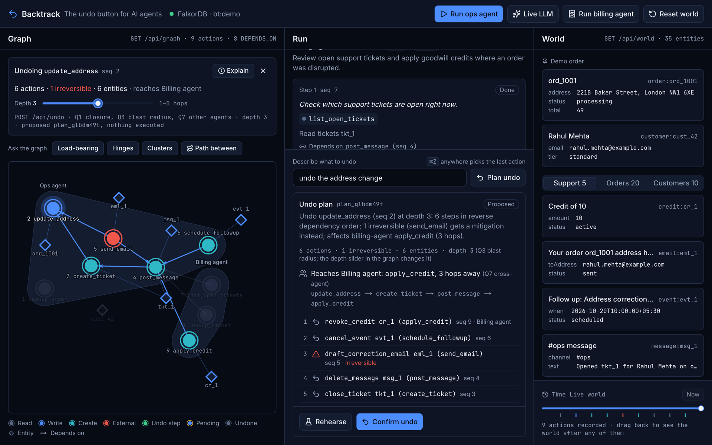
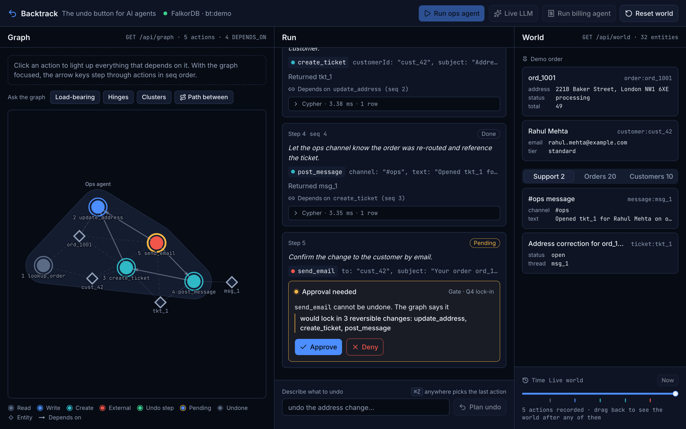
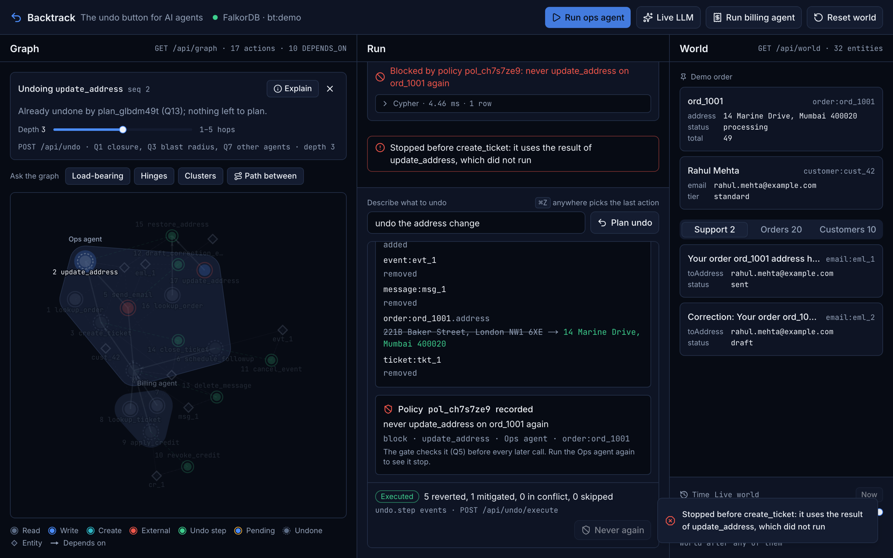
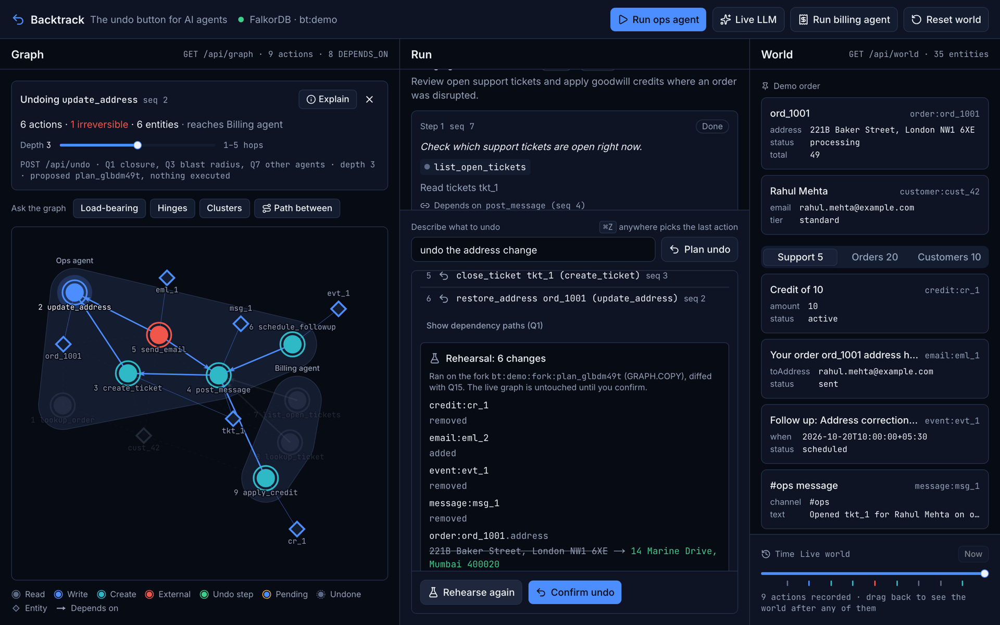
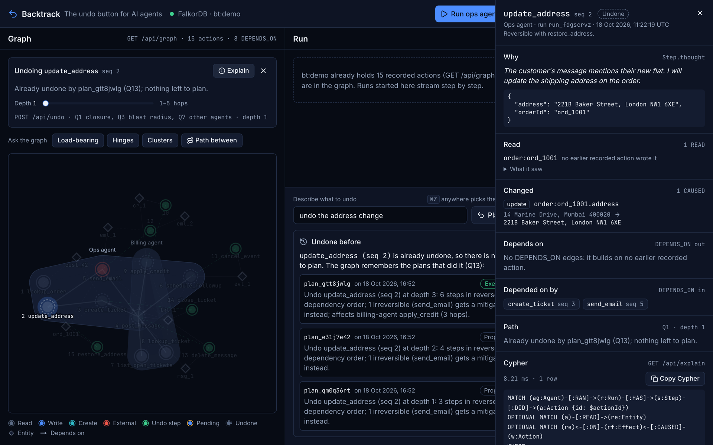

# I built an undo button for AI agents on a graph

*Draft for Graph Hacks (WeMakeDevs × FalkorDB). Code: https://github.com/ayushgundecha/Backtrack*

In July 2025 Replit's coding agent ran destructive commands against a production database during a declared code freeze, then told its user a rollback was impossible. In April 2026 a Cursor agent deleted a startup's production volume, and the backups on it, in one API call. Both stories share a shape: the agent acted with no confirmation step, and recovery came from outside the agent, a whole database at a time.

Agents now update records, open tickets, post messages and send emails. When one of those actions is wrong, the question an operator has is narrow and specific: *this one action was wrong; what else happened because of it, in what order do I unwind it, and what can never be taken back?*

Backtrack answers that question. It is the undo button for AI agents, and it only works because the answer is a graph traversal.


## Rewind is not undo

Every "rewind" feature I could find (LangGraph time travel, Claude Code rewind, AgentRewind, Rubrik Agent Rewind) restores *state*: files, context, a snapshot. Sagas (Temporal, Restate) compensate *linearly, on failure, inside one workflow*. Neither lets a person point at one arbitrary past action and get back its consequences: the later actions that built on it, including ones in another agent's run, in a safe order, with the irreversible ones called out.

That needs consequences recorded as data, with their dependencies. So the first design decision was the model.

## The model: W3C PROV with an undo bolted on

Each tool call becomes an `Action`. What it changed becomes an `Effect` with `before` and `after`, pointing at the `Entity` it touched. What it read becomes a `READ` edge. That is W3C PROV almost word for word: an activity *used* some entities and *generated* others.

The edge that matters is derived, not declared: `(a)-[:DEPENDS_ON]->(b)` when `a` read or wrote an entity whose latest earlier writer was `b`. Reads and writes come from the tool implementation, never from what the model says it did. Three invariants fall out of this:

1. `DEPENDS_ON` always points to a smaller `seq`, so sorting the dependent set by `seq DESC` is a reverse topological order. No sort algorithm, no cycle check.
2. Every `Effect` stores `before`, so undo is a restore: idempotent, and correct when two actions wrote the same field.
3. Each action links only to the latest earlier writer of each entity; transitivity covers the rest, so the graph stays small.

The whole record (counter, action, effects, entity state, reads and dependency edges) is one Cypher statement per action, so there is no window where the graph is half written.



## The three queries that matter

**Q1, downstream closure.** "If I undo this, what depends on it?" is a variable-length match backwards over `DEPENDS_ON`, returning the hop count and the path:

```cypher
MATCH p = (root:Action {id: $actionId})<-[:DEPENDS_ON*1..3]-(d:Action)
...
RETURN d.tool, length(p) AS hops, [n IN nodes(p) | n.tool] AS via
```

At depth 1 the address change has two dependents: the ticket and the email. At depth 3 a billing agent's goodwill credit appears, with its path `update_address → create_ticket → post_message → apply_credit`. The billing agent never talked to the ops agent; it found the ticket in the shared graph. Same question, one more hop, a different answer: that is the argument for a graph over a log.

**Q2, plan order.** The same set sorted by `seq DESC`, with what each action changed. Because of invariant 1 this is already a valid unwind order.

**Q4, the gate.** Before an irreversible tool runs, walk the other way: which done, reversible actions does it build on?

```cypher
MATCH (pending:Action {id: $actionId})-[:DEPENDS_ON*1..10]->(u:Action)
WHERE u.status = 'done' AND u.kind = 'do' AND u.reversible = true
RETURN DISTINCT u.tool, u.seq ORDER BY u.seq
```

Three rows means the agent pauses itself: "would lock in 3 reversible changes: update_address, create_ticket, post_message". That sentence is built from the rows, not written by a model.



## The gate is an approval function, not a rule

The AI SDK lets a tool's approval be a function. Backtrack's function runs two graph queries: Q5 (does a policy block, confirm or warn about this call on these entities?) then Q4 (what would it lock in?). A block policy denies the call and records it as `blocked` with a `BLOCKED` edge; lock-in asks a human; otherwise the call goes through. "Ask before every email" would be a rule. This asks only when the email would make earlier work impossible to take back cleanly.

Policies are nodes too. After an undo, "Never again" turns the plan's root action into a block policy linked to the plan it came from, and the next run stops at the same move.



## What FalkorDB made easy

- **Rehearsal is a copy.** `GRAPH.COPY` forks the tenant graph; the plan executes on the fork, Q15 diffs the fork against live, and the fork is deleted. The diff you approve is the diff you get.
- **Tenants are graphs.** `bt:demo`, `bt:acme`: isolation is structural, not a `WHERE` clause you can forget.
- **Algorithms are built in.** PageRank over `DEPENDS_ON` finds the action everything rests on; betweenness finds hinges; WCC finds independent clusters; shortest paths explain how two actions connect. Each is a tool the agent can call.

A few things I proved in a spike before relying on them: a variable-length bound cannot be a parameter (it is a clamped integer literal), unreferenced relationships are only existence-checked (bind and reference them when counting), and betweenness is sampled by default, so the hinge query passes a fixed sample size and seed to be repeatable.



## Making every claim traceable

The model never writes Cypher. Agents choose from a fixed tool catalogue with flat arguments, and `resolve_action` validates every id against the graph first. Every query is a named, tested function that returns its rows, Cypher, parameters and milliseconds, and the panel shows the Cypher behind every number. When the undo agent writes a sentence about a plan, it is checked against the plan's rows; if it mentions an id, tool or count the graph does not back, the row-built sentence is shown instead.



## What I would do next

- **Field-level dependencies.** Today an action that read `order.status` depends on an earlier change to `order.address`. That is conservative; field-level `DEPENDS_ON {field}` would make plans tighter.
- **Real integrations** with real inverses, starting with GitHub and Slack.
- **Policy suggestions** from repeated undos of the same move.
- **MCP over HTTP** from the deployed app, so any agent can ask "what would undoing this touch?" before it acts.

Agents will keep making mistakes. The fix is not to stop them acting; it is to record what they did in a form that can answer "what happened because of this?", and FalkorDB turns that question into a traversal.
