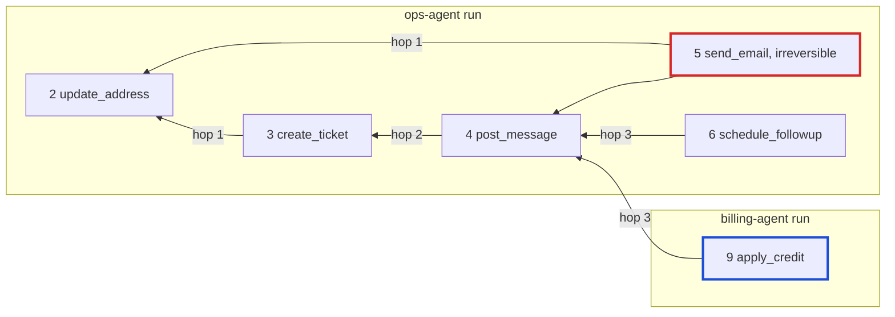

# Why a graph, not a log

Backtrack's headline features are not lookups. Each one is a question about what is reachable from an action over `DEPENDS_ON`. This page makes that argument on the golden demo graph, shows the query that answers it, and says plainly what a log or a table would need to answer the same question.

The model is in [`graph/model.md`](../graph/model.md). Queries are referred to by their number and name from `docs/PLAN.md` §5; their text is generated into [`graph/queries.cypher`](../graph/queries.cypher).

## Every feature is reachability

| Feature | The question | Traversal | Query |
|---|---|---|---|
| Undo order | What must be reverted before this action, and in what order? | downstream closure over incoming `DEPENDS_ON`, ordered `seq DESC` | Q1 downstream closure, Q2 undo plan |
| Blast radius | How many actions, how many irreversible, which entities? | the same closure, counted | Q3 blast-radius summary |
| Cross-agent cascade | Does another agent's work depend on this? | the same closure, grouped by agent | Q7 cross-agent dependents |
| Gate | Which reversible work would this irreversible action lock in? | upstream closure of the pending action over outgoing `DEPENDS_ON` | Q4 gate lock-in (after Q5 policy check) |
| Conflict | Has anything changed this entity since the action we are reverting? | for each action in the closure, `CAUSED → Effect → ON → Entity`, compare `state` with `after` | Q14 conflict check |
| Explanation | Why did this happen, what did it read, and who wrote that? | `READ → Entity ← ON ← Effect ← CAUSED ← writer`, plus the path chips from Q1 | Q6 explain |

The same edge answers all six. `DEPENDS_ON` is derived at record time from what each tool implementation read and wrote (never from the model's arguments), always points to a strictly smaller `seq`, and links only to the latest prior `done` writer of each entity. Because of the `seq` invariant, `seq DESC` over any closure is already a reverse topological order: the undo order needs no sort algorithm, only the traversal.

## Depth 1 versus depth 3 on the golden demo graph

The ops agent runs six steps, then the billing agent runs three. Arrows are `DEPENDS_ON`, from the dependent to what it depends on.



(The read-only actions `lookup_order`, `list_open_tickets` and `lookup_ticket` are left out: nothing depends on them, and the two billing reads are at hop 3 with nothing to revert.)

The user asks to undo `update_address`.

**At depth 1** the undo touches two dependents:

| Dependent | Hops | Path |
|---|---|---|
| `create_ticket` | 1 | `create_ticket → update_address` |
| `send_email` | 1 | `send_email → update_address` |

**At depth 3** the closure grows, and an action from a different agent appears, with the route that connects it:

| Dependent | Agent | Hops | Path |
|---|---|---|---|
| `create_ticket` | ops | 1 | `create_ticket → update_address` |
| `send_email` | ops | 1 | `send_email → update_address` |
| `post_message` | ops | 2 | `post_message → create_ticket → update_address` |
| `schedule_followup` | ops | 3 | `schedule_followup → post_message → create_ticket → update_address` |
| `apply_credit` | **billing** | 3 | `apply_credit → post_message → create_ticket → update_address` |

The billing agent never talked to the ops agent. It read the ticket the ops agent opened (and the ops agent's message had updated), so its credit was granted on the strength of an address change that is now being reverted. Nothing in the billing agent's own run says so; only the transitive path does.

Ordered by `seq DESC` (Q2 undo plan), the depth-3 plan is: `revoke_credit cr_1` (apply_credit) · `cancel_event evt_1` (schedule_followup) · `draft_correction_email` (send_email is irreversible, so it is recorded as `COULD_NOT_REVERT` with this mitigation) · `delete_message msg_1` (post_message) · `close_ticket tkt_1` (create_ticket) · `restore_address ord_1001` (update_address, the root, last).

## The query

This is the shape of Q1 downstream closure, as proven in `docs/spike-results.md`. The exact text lives in `packages/core/src/graph/queries.ts` and is generated into `graph/queries.cypher`.

```cypher
// answers: which done actions transitively depend on this one, how many hops away, and by which route?
MATCH p = (root:Action {id: $id})<-[:DEPENDS_ON*1..3]-(d:Action)
WHERE d.status = 'done' AND d.kind = 'do'
RETURN d.id AS id, d.tool AS tool, d.seq AS seq,
       length(p) AS hops,
       [n IN nodes(p) | n.tool] AS via
ORDER BY d.seq DESC
```

- The `3` is not a parameter. FalkorDB rejects a parameter as a variable-length bound (`*1..$depth` fails with `Encountered unhandled type in inlined properties`), so the engine clamps the requested depth to an integer between 1 and 10 and writes it into the query text. Every other value, including `$id`, stays a parameter.
- `length(p)` is the hop count and `nodes(p)` is the route, so the answer carries its own evidence. `nodes(p)` runs from the root outwards (`update_address, create_ticket, post_message, apply_credit`); read backwards it is the dependency chain shown above.
- The query returns one row per path. `send_email` is reachable twice at depth 3: directly (1 hop) and through `post_message` (3 hops). The plan reports each dependent once, at its shortest distance.
- The spike proves the depth behaviour directly: on a three-action chain, depth 1 hides the second hop. The depth slider in the UI re-runs Q1 with a new literal.

## What a log or a table would need

A log records what happened, in order. It is the right shape for "what did agent X do in run Y". It is the wrong shape for "what transitively depends on entry 2", for three reasons.

1. **A log has no dependency edges.** To find what depends on an entry you must first work out, for every later entry, which entities it read and who last wrote them. That is the `DEPENDS_ON` derivation, re-done at query time.
2. **Transitive means one join per hop.** Once you have materialized those edges into a table, "what depends on this, up to three hops, with the route" is a recursive query:

   ```sql
   -- answers the same question as Q1, over an edge table you had to build first
   WITH RECURSIVE downstream(id, hops, route) AS (
     SELECT e.dependent_id, 1, ARRAY[e.dependency_id, e.dependent_id]
     FROM depends_on e
     WHERE e.dependency_id = :root
     UNION ALL
     SELECT e.dependent_id, d.hops + 1, d.route || e.dependent_id
     FROM depends_on e
     JOIN downstream d ON e.dependency_id = d.id
     WHERE d.hops < 3
   )
   SELECT a.id, a.tool, min(d.hops) AS hops
   FROM downstream d JOIN actions a ON a.id = d.id
   WHERE a.status = 'done' AND a.kind = 'do'
   GROUP BY a.id, a.tool, a.seq
   ORDER BY a.seq DESC;
   ```

   This works. It is also a graph, stored as an adjacency table, queried by hand-written recursion. The other five questions (blast radius, cross-agent, gate, conflict, explanation) each need their own recursive query or application code that walks the edges.
3. **The algorithms are not there.** Load-bearing actions (Q8, `algo.pageRank`), hinge actions (Q9, `algo.betweenness`), independent clusters (Q10, `algo.wcc`) and the path between two actions (Q11, `algo.SPpaths`) are built into FalkorDB and exposed to agents as tools. A log has none of them.

In FalkorDB the edge is stored once, when the action is recorded, and every question is a pattern over it. The query reads like the question.

## Rehearsal is one command

Before confirming an undo, Backtrack rehearses it. Because the world state (`Entity.state`), the actions and the plans all live in one graph, a complete and consistent copy is a single `GRAPH.COPY`:

1. `graph.copy('bt:demo:fork:<planId>')` forks the tenant graph.
2. The real undo code runs against the fork.
3. Q15 rehearsal diff compares the fork with the live graph.
4. `GRAPH.DELETE` removes the fork. The live graph is untouched.

The spike verifies each step: the copy has the same nodes, the delete removes it, the source is unchanged. With a log plus a separate application database, a rehearsal would need a consistent snapshot of both.

## Graph per tenant

Each tenant is its own graph, `bt:<tenant>` (`bt:demo`, `bt:test`, `bt:acme`). Isolation is structural rather than a convention:

- No query can cross tenants, because the graph is chosen when the handle is opened, not in a `WHERE` clause someone can forget.
- `DEPENDS_ON` derivation can only ever link actions inside one tenant.
- Deleting or forking a tenant is one command (`GRAPH.DELETE`, `GRAPH.COPY`).
- Agents that should share state (the ops and billing agents) share it by writing to the same tenant graph; agents that should not, cannot.
