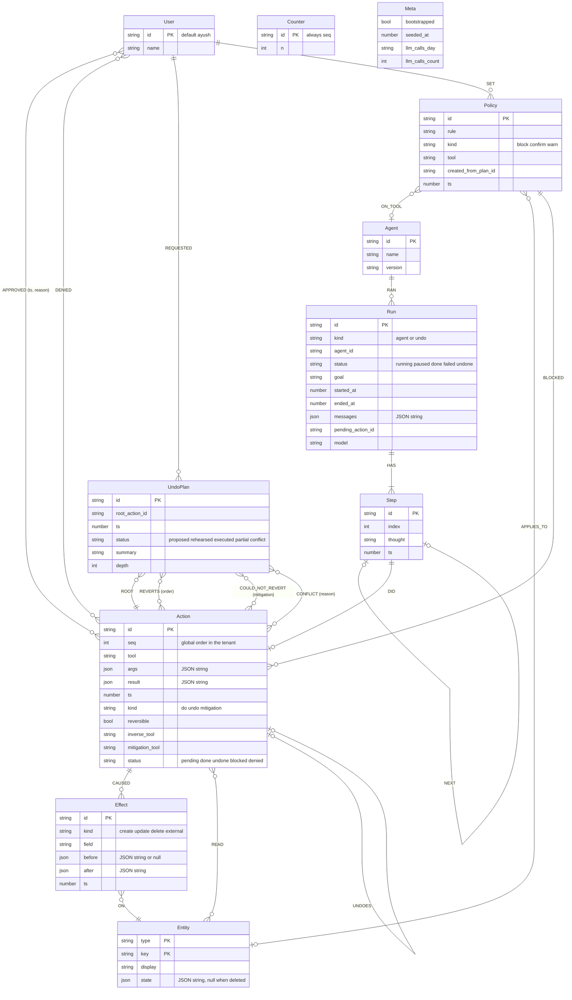
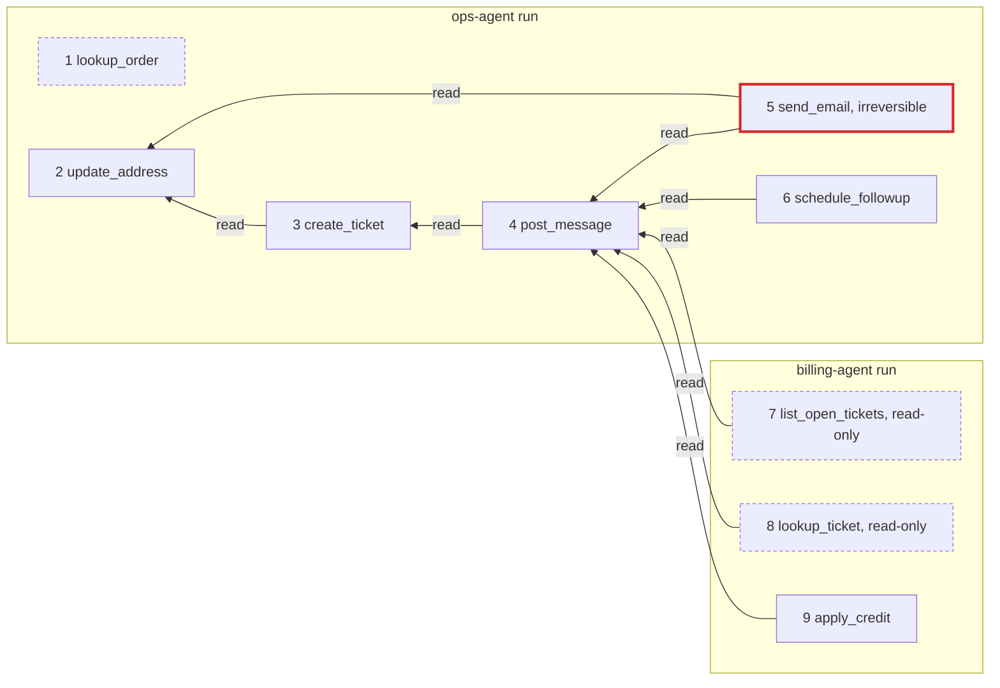

# Graph model

Backtrack stores every agent action as a cause-and-effect graph in FalkorDB. This page is the reference for the labels, edges, invariants and ids. The contract is frozen in `docs/PLAN.md` §4 and implemented in `packages/core/src/graph/`; the queries over it are in [`queries.cypher`](queries.cypher) (generated from `packages/core/src/graph/queries.ts`).

One graph per tenant: `bt:<tenant>`. `bt:demo` is the demo, `bt:test` is used by the tests, `bt:acme` shows isolation. A tenant is a graph, never a `WHERE` filter.

## Diagram

Every label and every edge. Edge properties are in parentheses. Cardinalities describe how the demo uses the model (for example, one action per step).

`Counter` and `Meta` have no edges: `Counter {id: 'seq'}` hands out the global `seq` inside the record statement, and `Meta` gates the idempotent bootstrap and counts live LLM calls per day.

## Labels

| Label | Properties | Notes |
|---|---|---|
| `Agent` | `id, name, version` | `ops-agent`, `billing-agent`; undo runs use `backtrack` |
| `User` | `id, name` | the human; default `ayush` |
| `Run` | `id, kind (agent, undo), agent_id, status (running, paused, done, failed, undone), goal, started_at, ended_at, messages (JSON string), pending_action_id, model` | an undo is its own run |
| `Step` | `id, index, thought, ts` | the agent's stated reason, before the tool call |
| `Action` | `id, seq (int), tool, args (JSON), result (JSON), ts, kind (do, undo, mitigation), reversible (bool), inverse_tool, mitigation_tool, status (pending, done, undone, blocked, denied)` | one recorded tool call |
| `Effect` | `id, kind (create, update, delete, external), field, before (JSON or null), after (JSON), ts` | one concrete change; `before` makes undo a restore |
| `Entity` | `type, key, display, state (JSON string)` | a thing in the synthetic world; the world lives in the graph |
| `UndoPlan` | `id, root_action_id, ts, status (proposed, rehearsed, executed, partial, conflict), summary, depth` | memory of every undo |
| `Policy` | `id, rule, kind (block, confirm, warn), tool, created_from_plan_id, ts` | "never again", learned from an undo |
| `Counter` | `id: 'seq', n` | global monotonic action sequence |
| `Meta` | `bootstrapped, seeded_at, llm_calls_day, llm_calls_count` | bootstrap gate and LLM budget |

Indexes and constraints (bootstrap): unique on `Action.id`, `Run.id`, `UndoPlan.id` and `Entity(type, key)` (each created as an exact-match index first, then the constraint); plain indexes on `Action.seq`, `Action.tool`, `Action.status` and `Entity.type`.

## Edges

| Edge | Properties | Written by | Meaning |
|---|---|---|---|
| `(Agent)-[:RAN]->(Run)` | | recorder | an agent ran a run |
| `(Run)-[:HAS]->(Step)` | | recorder | a run is made of steps |
| `(Step)-[:NEXT]->(Step)` | | recorder | step order within a run |
| `(Step)-[:DID]->(Action)` | | recorder | the tool call a step made |
| `(Action)-[:CAUSED]->(Effect)` | | recorder | a change the action made |
| `(Effect)-[:ON]->(Entity)` | | recorder | the entity that change applied to |
| `(Action)-[:READ]->(Entity)` | | recorder | an entity the tool implementation read |
| `(Action)-[:DEPENDS_ON]->(Action)` | `weight: 1`, `via: 'read' or 'write'` | recorder (derived) | the later action read or wrote an entity whose latest prior `done` writer is the earlier action |
| `(Action)-[:UNDOES]->(Action)` | | undo executor | an undo or mitigation action and the original it reverts |
| `(UndoPlan)-[:ROOT]->(Action)` | | undo planner | the action the user asked to undo |
| `(UndoPlan)-[:REVERTS]->(Action)` | `order` | undo planner | a step of the plan, in execution order |
| `(UndoPlan)-[:COULD_NOT_REVERT]->(Action)` | `mitigation` | undo executor | an irreversible action and what was done instead |
| `(UndoPlan)-[:CONFLICT]->(Action)` | `reason` | undo executor | a step skipped because its entity changed since (Q14) |
| `(User)-[:APPROVED]->(Action)` | `ts, reason` | gate | a human approved a gated action |
| `(User)-[:DENIED]->(Action)` | | gate | a human denied a gated action |
| `(User)-[:REQUESTED]->(UndoPlan)` | | undo planner | a human asked for this undo |
| `(User)-[:SET]->(Policy)` | | policies | a human set this policy |
| `(Policy)-[:ON_TOOL]->(Agent)` | | policies | the agent whose tool the policy governs |
| `(Policy)-[:APPLIES_TO]->(Entity)` | | policies | the entity the policy protects |
| `(Policy)-[:BLOCKED]->(Action)` | | policies | an action the policy stopped |

`weight: 1` is on every `DEPENDS_ON` because `algo.SPpaths` requires a `weightProp` (Q11, see `docs/spike-results.md`).

## Invariants

1. **`DEPENDS_ON` points to a strictly smaller `seq`.** So `seq DESC` over any dependent set is a reverse topological order, and `DEPENDS_ON` has no cycles.
2. **Every `Effect` has `before` and `after`.** Undo is a restore of `before` (a create restores to `null`): idempotent, and correct under write-after-write.
3. **Traversals exclude `status = 'undone'` and `kind <> 'do'`.** Undo and mitigation actions are never part of a plan, so undoing an undo is impossible.
4. **Reads and writes come from the tool implementation**, never from the model's arguments.
5. **`DEPENDS_ON` links only to the latest prior `done` writer of each entity**, one edge per pair. Transitivity covers earlier writers, so fan-in stays small.
6. **A tenant is a graph**, not a filter.

## DEPENDS_ON derivation

Inside the same single Cypher statement that records an action: for every entity the action read or wrote, find the latest prior `done` writer of that entity and create `(new)-[:DEPENDS_ON {weight: 1, via}]->(writer)`, with `via: 'read'` if the action read the entity and `'write'` otherwise; one edge per pair. Read-only actions get outgoing `DEPENDS_ON` edges, but nothing ever depends on them, because they wrote nothing.

## Ids and entities

| Node | Id |
|---|---|
| Action, Run, Step, Effect, UndoPlan, Policy | `act_`, `run_`, `stp_`, `eff_`, `plan_`, `pol_` followed by an 8-character nanoid |
| Entity | `{type, key}`; string form `type:key`, e.g. `order:ord_1001` |
| World keys created by tools | per-type counter: `tkt_1`, `msg_1`, `evt_1`, `eml_1`, `cr_1` |

| Entity type | `state` (canonical JSON, sorted keys) |
|---|---|
| `customer` | `{id, name, email, tier}`; seed `cust_41` to `cust_50`, demo customer `cust_42` (Rahul Mehta) |
| `order` | `{id, customerId, items, total, address, status}`; seed `ord_1001` to `ord_1020`, demo order `ord_1001` |
| `ticket` | `{id, customerId, orderId, subject, body, status, thread}` |
| `message` | `{id, channel, text, ticketId}` |
| `event` | `{id, ticketId, title, when, status}` (calendar) |
| `email` | `{id, to, toAddress, subject, body, status}` (`sent` or `draft`) |
| `credit` | `{id, customerId, ticketId, amount, reason, status}` |

A deleted or not-yet-existing entity has `state` `null` and is hidden from the world panel.

## Tools and their inverses

| Tool | Agent | Reads | Writes | Reversible | Inverse or mitigation |
|---|---|---|---|---|---|
| `lookup_order` | ops | order, customer | | read-only | |
| `update_address` | ops | order | update `order.address` | yes | `restore_address` |
| `create_ticket` | ops | customer, order | create ticket | yes | `close_ticket` |
| `post_message` | ops | ticket | create message; update `ticket.thread` | yes | `delete_message` |
| `send_email` | ops | customer, order, ticket | external email (status `sent`) | **no** | mitigation `draft_correction_email` (email with status `draft`) |
| `schedule_followup` | ops | ticket | create event | yes | `cancel_event` |
| `list_open_tickets` | billing | every open ticket | | read-only | |
| `lookup_ticket` | billing | ticket | | read-only | |
| `apply_credit` | billing | customer, the customer's open ticket | create credit | yes | `revoke_credit` |

## The golden demo graph

The ops run (seq 1 to 6) followed by the billing run (seq 7 to 9). Arrows are `DEPENDS_ON`, from the dependent to what it depends on. Every edge here is `via: 'read'`, because each tool reads the entity it builds on.

| seq | Tool | Depends on | Hops from `update_address` |
|---|---|---|---|
| 1 | `lookup_order` | | |
| 2 | `update_address` | | root |
| 3 | `create_ticket` | `update_address` | 1 |
| 4 | `post_message` | `create_ticket` | 2 |
| 5 | `send_email` (gated) | `update_address`, `post_message` | 1 |
| 6 | `schedule_followup` | `post_message` | 3 |
| 7 | `list_open_tickets` (billing, read-only) | `post_message` | 3 |
| 8 | `lookup_ticket` (billing, read-only) | `post_message` | 3 |
| 9 | `apply_credit` (billing) | `post_message` | 3 |

- **Gate before `send_email`** (Q4 gate lock-in: the upstream closure of the pending action, keeping reversible `done` actions with effects): "would lock in 3 reversible changes: update_address, create_ticket, post_message".
- **Undo of `update_address`** (Q1 downstream closure, Q2 undo plan): depth 1 reaches `create_ticket` and `send_email`; depth 2 adds `post_message`; depth 3 adds `schedule_followup` and the billing agent's `apply_credit`, path `apply_credit → post_message → create_ticket → update_address`. Read-only dependents have nothing to revert and are not plan steps.
- **Plan at depth 3 or more**, `seq DESC`: `revoke_credit cr_1` (apply_credit, billing agent) · `cancel_event evt_1` (schedule_followup) · `draft_correction_email` (send_email: `COULD_NOT_REVERT` with the mitigation) · `delete_message msg_1` (post_message) · `close_ticket tkt_1` (create_ticket) · `restore_address ord_1001` (update_address, the root, last).
